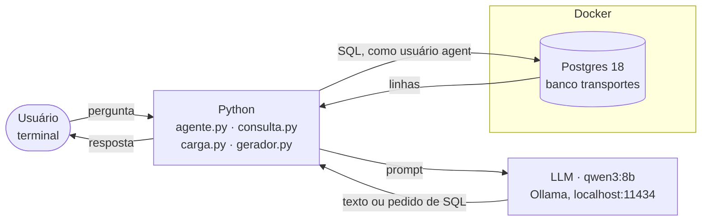
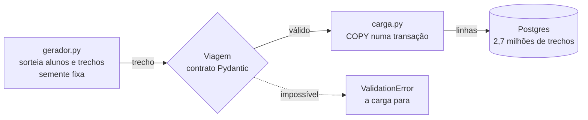
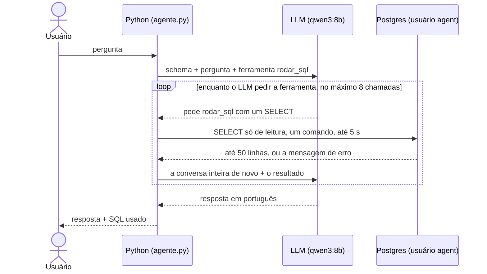
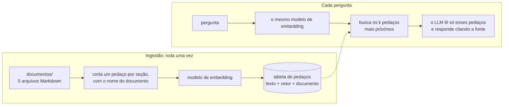

# campus-mobility-agent

Assistente de dados para a reitoria de uma universidade com cerca de
7.000 alunos. Responde perguntas sobre o transporte dos alunos
consultando um star schema em Postgres (text-to-SQL com guardrails) e
documentos da reitoria (RAG).

Os dados e os documentos são sintéticos. O LLM roda local, pelo Ollama:
o projeto não tem custo por token.

## Como funciona

O sistema tem quatro peças, e o Python é a única que fala com todas. O
LLM nunca acessa o banco: ele lê o texto que o Python manda e devolve
texto.



### Carga dos dados

Roda uma vez e enche o banco. O LLM não participa.



Todo trecho passa pela `Viagem` antes de virar linha do fato. A carga é
uma transação só: ou tudo entra, ou o banco fica como estava.

### Uma pergunta ao agente



Uma pergunta custa pelo menos duas chamadas ao LLM: na primeira ele
escreve o SQL, na segunda lê o resultado e responde. O LLM não guarda a
conversa, então cada chamada reenvia tudo o que veio antes. Se o SQL der
erro, a mensagem do banco volta para o LLM, que tenta de novo.

Os guardrails ficam em camadas, para que um bug numa delas não abra o
banco:

| Barreira | Onde fica | O que segura |
|---|---|---|
| Usuário `agent` só com `SELECT` | Postgres (`modelo/leitor.sql`) | Qualquer escrita, mesmo com bug no Python |
| Transação só de leitura | `consulta.py` | Escrita, recusada antes de chegar à permissão |
| Um comando por vez | `consulta.py` | Um segundo comando que desligaria o teto de tempo |
| Teto de 5 s por consulta | Postgres e `consulta.py` | Um `SELECT` pesado travando o banco |
| No máximo 50 linhas | `consulta.py` | Um resultado enorme enchendo o contexto do LLM |
| No máximo 8 chamadas ao LLM | `agente.py` | O LLM preso num loop |

### RAG

O RAG responde o que não está no banco: as regras e os horários escritos
pela reitoria. Já estão prontos os documentos, o gabarito da busca e o
desenho do corte em pedaços. A ingestão está em construção, e faltam os
embeddings, o pgvector e a busca.

**Documentos** (`documentos/`, 5 arquivos Markdown, cerca de 1.700
palavras, divididos em seções):

| Documento | Conteúdo |
|---|---|
| `regras_fretados` | Regulamento do fretado estudantil: quem pode usar, custo, onde embarcar, dias de operação, lotação |
| `fretados_horarios` | Quadro de horários das linhas do fretado |
| `rota_onibus` | Como chegar ao campus de ônibus, metrô e trem |
| `campus_curso` | Guia dos setores do campus por curso |
| `auxilio_transporte` | Regras do auxílio-transporte estudantil |

Os documentos dividem vocabulário de propósito (ponto, portão, horário,
tarifa), para que a busca tenha que separar assuntos vizinhos.

**Gabarito da busca** (`avaliacao/golden_set_rag.yaml`): 10 perguntas,
escritas antes de existir a busca. Cada uma traz os documentos que a
respondem (acerto se um trecho de qualquer um deles vier entre os k
trazidos) e a armadilha, o documento vizinho que pode enganar a busca.
Quatro perguntas usam uma palavra diferente da do documento, para medir
se a busca acha pelo sentido e não pela palavra igual. Alguns exemplos:

| Pergunta | Documento certo | Armadilha |
|---|---|---|
| "posso levar minha bike no fretado?" | `regras_fretados` | o documento diz "bicicleta" |
| "até que horas sai o último fretado de volta pra Osasco?" | `fretados_horarios` | o `rota_onibus` tem o horário do último circular |
| "em qual prédio têm aula os alunos de medicina?" | `campus_curso` | o documento diz "bloco" e "setor" |
| "o auxílio-transporte reembolsa corrida de uber?" | `auxilio_transporte` | o documento diz "transporte por aplicativo" |

**O fluxo planejado:** a ingestão roda uma vez e prepara os pedaços.
Depois, cada pergunta faz uma busca e uma geração.



- **Corte (decidido; o teste está em `tests/test_ingestao.py`):** um
  pedaço por seção do documento, e o trecho antes da primeira seção vira
  um pedaço também. O vetor de um assunto só fica mais perto da pergunta
  do que o vetor de um documento inteiro, e o LLM recebe só o trecho que
  importa.
- **Avaliação:** a busca é medida pelo recall@k contra o gabarito acima.
  Por isso cada pedaço guarda o nome do documento de onde saiu: é ele
  que se compara com a lista de documentos de cada pergunta.

## Estado atual

Já existem:

- Star schema em `modelo/schema.sql`: `fato_transportes` (9 chaves, 3
  métricas) e 6 dimensões (`dim_modal`, `dim_categoria`, `dim_hora`,
  `dim_local`, `dim_data` e `dim_usuario`, esta como SCD tipo 2).
  Postgres 18 local via `modelo/docker-compose.yml`.
- Contrato `Viagem` (Pydantic) em `src/assistente/contrato.py`, que
  recusa a viagem que chega antes de sair.
- Gerador de dados sintéticos em `src/assistente/gerador.py`: 7.000
  alunos em 21 bairros de São Paulo, Osasco e Taboão da Serra, ano letivo
  de 2026, cerca de 2,7 milhões de trechos no fato. As premissas
  (velocidade, tarifa, turnos, calendário) ficam declaradas no topo do
  arquivo. Mesma semente, mesmos dados.
- Carga no Postgres em `src/assistente/carga.py`, que pode rodar de novo
  e recarrega do zero.
- Agente text-to-SQL em `src/assistente/agente.py`, com a ferramenta
  `rodar_sql` em `src/assistente/consulta.py` e os guardrails da tabela
  acima. Os testes do loop usam um LLM falso.
- Golden set do agente em `avaliacao/golden_set.yaml`: 11 perguntas da
  reitoria, cada uma com a decisão que apoia e a armadilha que ela
  esconde.
- Do RAG: os 5 documentos da reitoria, o gabarito da busca com 10
  perguntas e o desenho do corte em pedaços (ver [RAG](#rag)).

Em andamento: a ingestão do RAG. O teste do corte está em
`tests/test_ingestao.py`; a função ainda não.

Próximos passos:

1. RAG: embeddings locais, pgvector, busca, recall@k e a busca ligada ao
   agente, com citação de fonte.
2. API: FastAPI async na frente do agente, em Docker multi-stage.
3. Operação: tracing com Langfuse, testes no GitHub Actions e deploy.

## Stack

Em uso: Python 3.14 (fixo em `.python-version`, via uv), Pydantic,
pytest, Postgres 18 em Docker, Ollama (qwen3:8b, chamado pelo SDK da
Anthropic).

Planejado: pgvector, FastAPI, Langfuse, GitHub Actions, GCP (Cloud Run).

## Comandos

```bash
uv sync          # cria o .venv com o Python e as dependências fixos
uv run pytest    # roda os testes

# sobe o Postgres e cria o schema (só na primeira vez)
cd modelo && docker compose up -d && cd ..
docker compose -f modelo/docker-compose.yml exec -T database \
  psql -U alfred -d transportes < modelo/schema.sql

# gera os dados e carrega
export PGPASSWORD=<senha do compose>
uv run python -m assistente.carga                            # 7.000 alunos, cerca de 1 min
uv run python -m assistente.carga --alunos 500 --semente 1   # carga menor

# usuário do agente (só na primeira vez); senhas no .env, ver .env.example
cp .env.example .env    # preencha AGENTE_SENHA
set -a && source .env && set +a
docker compose -f modelo/docker-compose.yml exec -T database \
  psql -U alfred -d transportes -v ON_ERROR_STOP=1 -v senha="$AGENTE_SENHA" < modelo/leitor.sql

# pergunta ao agente (o Ollama precisa estar rodando), e os testes que usam o banco
ollama pull qwen3:8b    # só na primeira vez, 5,2 GB
uv run --env-file .env python -m assistente.agente "quantas chegadas ao campus no ano?"
uv run --env-file .env pytest
```
